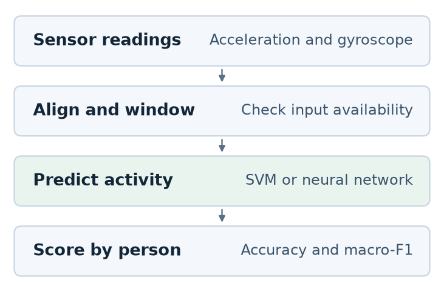

# Robust Human Activity Recognition on Edge Devices

**ONGOING · Preliminary research release**

Can a phone recognize walking, stairs and everyday postures from its motion sensors when the person using it was absent from training? This is my final-year CSE research project. I use accelerometer and gyroscope data to study where activity recognition works and where it breaks before relying on it on a phone.



I started with UCI HAPT to test the pipeline. The main experiments use seven activities from RealWorld HAR. I aligned the two sensor streams by timestamp, tracked windows with missing input, and compared an SVM using engineered features with neural models that read the sensor windows directly. The SVM comparison also tests what changes when 12 lag features are added to the original 48.

## Development results

Each fit excluded the participant it evaluated. The scores give equal weight to nine participants at familiar thigh and waist placements. I used this benchmark repeatedly during development. Independent validation is still pending.

| Model | Accuracy | Macro-F1 |
| --- | ---: | ---: |
| CNN-GRU C11 | 71.97% | 70.93% |
| B11Q RBF-SVM | 73.81% | 73.12% |
| D60 RBF-SVM | 76.60% | 76.19% |
| Attention-Residual BiGRU | 75.43% | 74.70% |

D60 remains the development comparator. Its lowest participant macro-F1 was **61.71%**. When scheduled predictions without usable input count as misses, its mean macro-F1 drops to **70.37%**. Walking and stairs still get confused, and some posture errors are concentrated in particular participants. The model runs did not all use the same training recipe. B11Q and D60 form the closer feature comparison because they use the same training rows and weights. [Methods](docs/methods.md) · [Results and experiment history](docs/results.md)

## Run the public examples

Use Python 3.12. The first example aligns generated sensor streams, extracts features, fits a small SVM and scores a held synthetic group. The second redraws the D60 confusion matrix from saved aggregate counts. Exact benchmark replay requires the original research data, splits and model states.

```sh
python3.12 -m venv .venv
source .venv/bin/activate
python -m pip install -r requirements.txt
python -m examples.synthetic_pipeline
python -m examples.plot_confusion
python -m unittest discover -s tests -v
```

## Current Status and Future Work

Model development is ongoing. In EXP066, parallel dilations improved macro-F1 over a matched CNN in five of nine source-validation choices. None met the preset criteria for advancement, and all scored below D60 on the corresponding source windows.

Phone validation is still incomplete. B11Q was tested in an earlier offline phone prototype. A Swift port of one D60 fold matched offline fixtures and built for iOS. Live D60 operation, reliable recognition at unfamiliar placements and sustained device performance remain open. The next research questions are how to improve walking and posture recognition for weaker participants, and how to measure placement and orientation effects using separately annotated phone sessions.

[Dataset access and licensing](docs/data-and-licensing.md)
