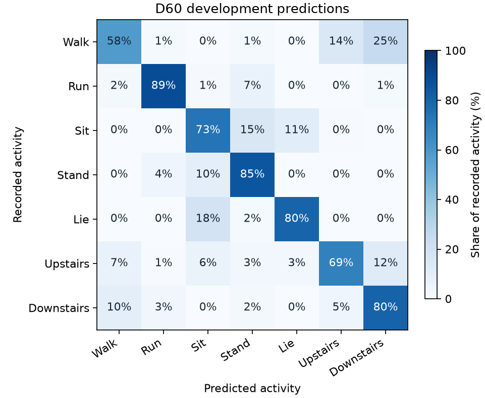

# Results and experiment history

The main benchmark uses nine held participants and familiar thigh and waist placements. Of 155,845 scheduled predictions, 133,982 had usable input. Coverage was 85.97% across all scheduled windows and 85.92% when averaged by participant.

| Model | Eligible macro-F1 | Lowest participant F1 | All-scheduled macro-F1 |
| --- | ---: | ---: | ---: |
| CNN-GRU C11 | 70.93% | 57.69% | 65.47% |
| B11Q RBF-SVM | 73.12% | 59.22% | 67.51% |
| D60 RBF-SVM | 76.19% | 61.71% | 70.37% |
| Attention-Residual BiGRU | 74.70% | 58.53% | 68.94% |

The CSV contains the original C11, B11Q and D60 aggregates. The attention row comes from the verified EXP064 reference readout, which records the original model and the matching epoch-40 comparison. EXP065 independently recorded D60 at 76.189786% eligible macro-F1 and 76.597435% participant-averaged accuracy. [Saved comparison CSV](../results/model_comparison.csv)

D60 called 24.6% of recorded walking windows downstairs and 14.5% upstairs. It called 15.2% of sitting windows standing and 18.1% of lying windows sitting. These pooled counts show which activities the model confused. They do not identify the physical cause of the errors. [Pooled counts](../results/d60_confusion.csv)

## Later comparisons

| Study | What we learned |
| --- | --- |
| EXP054 | The TinyHAR adaptation scored 64.69% macro-F1 versus 70.93% for matched C11. The adaptation used the C11 training recipe. |
| EXP055 to EXP059 | A history and literature review guided comparisons of other classifiers, orientation features and neural models. Under fixed rotation tests, one orientation representation improved the rotated score but lost 17.14 points of macro-F1 on unrotated inputs. Attention-Residual BiGRU reached 74.70% on the main development benchmark. |
| EXP060 to EXP061 | Fusion sometimes raised mean F1. The EXP060 attention fusion reached 76.76%, below its required gain, and introduced a zero-correct participant/site/activity cell. The EXP061 guarded rule fell back to D60 for all nine choices. |
| EXP062 to EXP065 | Mean-preserving smoothing, altered mean/motion features, attention checkpoint selection and SVM hyperparameter selection were tested. None replaced D60. The EXP065 policy fell back to the saved D60 setting for all nine choices. |
| AdamW source study | The November recovery run completed all 26 fresh fits. None of nine source choices passed the criteria for the tested weight-decay change. |
| EXP066 | The parallel-dilation CNN beat a matched single-scale CNN in five of nine held-source choices and beat aligned saved D60 in zero. It passed zero advancement checks after 26 completed fits. |

EXP066 matched the training rows, weights, training budget and parameter count between its two CNNs. The three branch dilations changed from (3, 3, 3) to (1, 3, 5). Both models had 3,983 parameters. The test used selected eligible source windows and the nine choices overlap. It produced no outer evaluation or independent test score. [CNN implementation](../src/models.py)

## Phone evidence

B11Q is the last historically verified installed phone reference. A Swift implementation of one D60 fold matched 151 offline fixtures and built as an unsigned iOS target. The D60 port still needs live sensor integration and testing on the phone. Accuracy at unfamiliar placements, repeatability after remounting, and continuous device latency and energy use are open questions.
